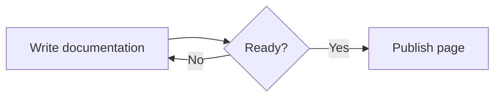

export const cards = [
  {
    title: "Text Card",
    description: "Card with a fancy description."
  },
  {
    title: "Link Card",
    description: "Card with a fancy link.",
    href: "https://google.com"
  }
];

## Reusable snippets

Database-backed projects can reuse the same Markdown or MDX across multiple pages. Open **Project tools → Reusable snippets**, create a named snippet, and insert it into a page:

```mdx
<Snippet name="authentication-note" />
```

When the snippet is updated, every draft, preview, and published page that references it uses the latest content. Snippet tags inside fenced code examples are left unchanged.

## Callout
<Tabs>
  <Tab label="Preview">

<Callout title="Info" type="info">
This is the style applied if the card type is set to "info" or "note." This is also applied if no type is specified.
</Callout>

<Callout title="Warning" type="warning">
This is the style applied if the card type is set to "warning."
</Callout>

<Callout title="Danger" type="danger">
This is the style applied if the card type is set to "danger."
</Callout>

<Callout title="Success" type="success">
This is the style applied if the card type is set to "success."
</Callout>

  </Tab>

  <Tab label="Code">

```mdx
<Callout title="Info" type="info">
  This is the style applied if the card type is set to "info" or "note."
</Callout>

<Callout title="Warning" type="warning">
  This is the style applied if the card type is set to "warning."
</Callout>

<Callout title="Danger" type="danger">
  This is the style applied if the card type is set to "danger."
</Callout>

<Callout title="Success" type="success">
  This is the style applied if the card type is set to "success."
</Callout>
```

  </Tab>
</Tabs>

## Metrics and progress

Use compact metrics for statistics throughout your documentation. Progress values are clamped between 0 and 100.

<Tabs>
  <Tab label="Preview">

<MetricGrid>
  <Metric label="API uptime" value="99.98%" change="+0.12%" />
  <Metric label="Open issues" value="7" change="-3 this week" />
  <Metric label="Coverage" value="84%" change="Needs review" tone="warning" />
</MetricGrid>

<Progress label="Migration progress" value={72} description="18 of 25 services are using the new API." />

  </Tab>
  <Tab label="Code">

```mdx
<MetricGrid>
  <Metric label="API uptime" value="99.98%" change="+0.12%" />
  <Metric label="Open issues" value="7" change="-3 this week" />
  <Metric label="Coverage" value="84%" change="Needs review" tone="warning" />
</MetricGrid>

<Progress
  label="Migration progress"
  value={72}
  description="18 of 25 services are using the new API."
/>
```

  </Tab>
</Tabs>

## Bar chart

Bar charts are useful for small comparisons. Arvlo automatically scales the chart unless you provide a `max` value.

<Tabs>
  <Tab label="Preview">

<BarChart
  title="Requests by region"
  description="Successful requests in the last 24 hours"
  suffix="k"
  data={[
    { label: "US East", value: 48 },
    { label: "US West", value: 34 },
    { label: "Europe", value: 41 },
    { label: "Asia", value: 27 },
  ]}
/>

  </Tab>
  <Tab label="Code">

```mdx
<BarChart
  title="Requests by region"
  description="Successful requests in the last 24 hours"
  suffix="k"
  data={[
    { label: "US East", value: 48 },
    { label: "US West", value: 34 },
    { label: "Europe", value: 41 },
    { label: "Asia", value: 27 },
  ]}
/>
```

  </Tab>
</Tabs>

## Mermaid diagrams

Use a `mermaid` code fence to turn Mermaid syntax into a rendered diagram. Flowcharts, sequence diagrams, state diagrams, and the other Mermaid diagram types work in previews and published pages.

<Tabs>
  <Tab label="Preview">



  </Tab>
  <Tab label="Code">

````md

````

  </Tab>
</Tabs>

## Image gallery

Galleries scroll horizontally and use snap points for easier browsing. Set `autoScroll` to advance automatically, customize the delay with `interval` in milliseconds, and use `pauseOnHover` or `loop` to control the behavior.

<Tabs>
  <Tab label="Preview">

<ImageGallery
  autoScroll={true}
  interval={3500}
  pauseOnHover={true}
  loop={true}
  images={[
    { src: "https://images.unsplash.com/photo-1501785888041-af3ef285b470?auto=format&fit=crop&w=1200&q=80", alt: "Mountains reflected in a lake", caption: "Alpine lake" },
    { src: "https://images.unsplash.com/photo-1519608487953-e999c86e7455?auto=format&fit=crop&w=1200&q=80", alt: "City skyline at night", caption: "City lights" },
    { src: "https://images.unsplash.com/photo-1507525428034-b723cf961d3e?auto=format&fit=crop&w=1200&q=80", alt: "Tropical beach and turquoise water", caption: "Tropical coast" },
    { src: "https://images.unsplash.com/photo-1448375240586-882707db888b?auto=format&fit=crop&w=1200&q=80", alt: "Sunlight through a dense forest", caption: "Forest trail" },
    { src: "https://images.unsplash.com/photo-1509316785289-025f5b846b35?auto=format&fit=crop&w=1200&q=80", alt: "Desert rock formations", caption: "Desert landscape" },
    { src: "https://images.unsplash.com/photo-1470770841072-f978cf4d019e?auto=format&fit=crop&w=1200&q=80", alt: "Cabin beside a mountain lake", caption: "Quiet retreat" },
  ]}
/>

  </Tab>
  <Tab label="Code">

```mdx
<ImageGallery
  autoScroll={true}
  interval={3500}
  pauseOnHover={true}
  loop={true}
  images={[
    { src: "/screenshots/dashboard.png", alt: "Project dashboard", caption: "Dashboard" },
    { src: "/screenshots/editor.png", alt: "Documentation editor", caption: "Editor" },
  ]}
/>
```

  </Tab>
</Tabs>

## Expandable details

Use expandable sections for optional context, troubleshooting notes, or long explanations.

<Expandable title="Why does this request require an idempotency key?">
The key prevents retries from creating the same resource more than once. Reuse it only when retrying the original request.
</Expandable>

```mdx
<Expandable title="Why does this request require an idempotency key?">
  The key prevents retries from creating the same resource more than once.
</Expandable>
```

## Interactive checklist

Checklist state is remembered on the reader's device when `storageKey` is set. Keep that key stable so progress survives page reloads.

<Tabs>
  <Tab label="Preview">

<Checklist
  title="Launch checklist"
  storageKey="launch-guide"
  items={[
    { label: "Create a project", complete: true },
    { label: "Connect a repository" },
    { label: "Review the preview" },
    { label: "Publish the documentation" },
  ]}
/>

  </Tab>
  <Tab label="Code">

```mdx
<Checklist
  title="Launch checklist"
  storageKey="launch-guide"
  items={[
    { label: "Create a project", complete: true },
    { label: "Connect a repository" },
    { label: "Review the preview" },
    { label: "Publish the documentation" },
  ]}
/>
```

  </Tab>
</Tabs>

## Card Grid
<Tabs>
  <Tab label="Preview">

<CardGrid cards={cards} />

  </Tab>

  <Tab label="Code">

```mdx
<CardGrid cards={cards} />
```

  </Tab>
</Tabs>

## Tabs
<Tabs>
  <Tab label="Preview">

<Tabs>
  <Tab label="npm">

```bash
npm install astro
```

  </Tab>

  <Tab label="pnpm">

```bash
pnpm add astro
```

  </Tab>
</Tabs>

  </Tab>

  <Tab label="Code">

````mdx
<Tabs>
  <Tab label="npm">
    ```bash
    npm install astro
    ```
  </Tab>

  <Tab label="pnpm">
    ```bash
    pnpm add astro
    ```
  </Tab>
</Tabs>
`````

  </Tab>
</Tabs>


## File Tree

<Tabs>
  <Tab label="Preview">

<FileTree
items={[
{
name: "src",
type: "folder",
children: [
{
name: "components",
type: "folder",
children: [
{ name: "Callout.astro" },
{ name: "CardGrid.astro" },
{ name: "Tabs.astro" },
{ name: "FileTree.astro" },
],
},
{ name: "pages", type: "folder" },
],
},
{ name: "astro.config.mjs" },
]}
/>

  </Tab>

  <Tab label="Code">

```mdx
<FileTree
  items={[
    {
      name: "src",
      type: "folder",
      children: [
        {
          name: "components",
          type: "folder",
          children: [
            { name: "Callout.astro" },
            { name: "CardGrid.astro" },
            { name: "Tabs.astro" },
            { name: "FileTree.astro" },
          ],
        },
        { name: "pages", type: "folder" },
      ],
    },
    { name: "astro.config.mjs" },
  ]}
/>
```

  </Tab>
</Tabs>


## Steps

<Tabs>
  <Tab label="Preview">

<Steps>
  <Step title="Install the package">
    Run the install command.
  </Step>

  <Step title="Configure your environment">
    Add your API key.
  </Step>
</Steps>

  </Tab>

  <Tab label="Code">

```mdx
<Steps>
  <Step title="Install the package">
    Run the install command.
  </Step>

  <Step title="Configure your environment">
    Add your API key.
  </Step>
</Steps>
```

  </Tab>
</Tabs>

## Do's and Don'ts
<Tabs>
  <Tab label="Preview">

<DoDont>
  <Do>
    Store secrets in environment variables.
  </Do>

  <Dont>
    Commit API keys to your repository.
  </Dont>
</DoDont>

  </Tab>

  <Tab label="Code">

```mdx
<DoDont>
  <Do>
    Store secrets in environment variables.
  </Do>

  <Dont>
    Commit API keys to your repository.
  </Dont>
</DoDont>
```

  </Tab>
</Tabs>

## API Block
<Tabs>
  <Tab label="Preview">

<ApiBlock
method="POST"
path="/api/incidents"
description="Create a new incident."
params={[
{
name: "title",
type: "string",
required: true,
description: "The incident title.",
},
{
name: "priority",
type: "low | medium | high",
description: "The incident priority.",
},
]}
responses={[
{
status: 201,
description: "Incident created.",
},
{
status: 400,
description: "Invalid request body.",
},
]}

>

```json
{
  "title": "Building fire",
  "priority": "high"
}
```

</ApiBlock>

  </Tab>

  <Tab label="Code">

````mdx
<ApiBlock
  method="POST"
  path="/api/incidents"
  description="Create a new incident."
  params={[ ... ]}
  responses={[ ... ]}
>

```json
{
  "title": "Building fire",
  "priority": "high"
}
```

</ApiBlock>
````

  </Tab>
</Tabs>

## Recipe
<Tabs>
  <Tab label="Preview">

<Recipe
title="Upload a file to S3"
description="This guide walks you through uploading a file using the SDK."

>

<RecipeStep title="Install the SDK">

```bash
npm install @aws-sdk/client-s3
```

</RecipeStep>

<RecipeStep title="Initialize the client">

```ts
const client = new S3Client({ region: "us-east-1" });
```

</RecipeStep>

<RecipeStep title="Upload the file">

```ts
await client.send(new PutObjectCommand({
  Bucket: "my-bucket",
  Key: "file.txt",
  Body: file
}));
```

</RecipeStep>

<RecipeResult>
Your file is now available in S3.
</RecipeResult>

</Recipe>

  </Tab>

  <Tab label="Code">

```mdx
<Recipe
  title="Upload a file to S3"
  description="This guide walks you through uploading a file using the SDK."
>
  ...
</Recipe>
```

  </Tab>
</Tabs>

## Tooltip
<Tabs>
  <Tab label="Preview">

A <Tooltip text="A unique identifier for a record.">UUID</Tooltip> is generated automatically.

  </Tab>

  <Tab label="Code">

```mdx
A <Tooltip text="A unique identifier for a record.">UUID</Tooltip> is generated automatically.
```

  </Tab>
</Tabs>

## Version Badge
<Tabs>
  <Tab label="Preview">

<VersionBadge version="v2.1+" />

  </Tab>

  <Tab label="Code">

```mdx
<VersionBadge version="v2.1+" />
```

  </Tab>
</Tabs>

## Status Badge
<Tabs>
  <Tab label="Preview">

<Status type="stable" icon="circle-check" />
<Status type="beta" icon="flask-conical" color="violet" />
<Status type="deprecated" label="Removed soon" icon="triangle-alert" color="red" />
<Status type="new" label="Just shipped" icon="rocket" library="fontawesome" color="blue" />

**Named color palette**

<Status type="stable" label="Green" color="green" />
<Status type="stable" label="Lime" color="lime" />
<Status type="stable" label="Teal" color="teal" />
<Status type="stable" label="Cyan" color="cyan" />
<Status type="stable" label="Blue" color="blue" />
<Status type="stable" label="Violet" color="violet" />
<Status type="stable" label="Pink" color="pink" />
<Status type="stable" label="Rose" color="rose" />
<Status type="stable" label="Amber" color="amber" />
<Status type="stable" label="Orange" color="orange" />
<Status type="stable" label="Red" color="red" />
<Status type="stable" label="Gray" color="gray" />

  </Tab>

  <Tab label="Code">

```mdx
<Status type="stable" icon="circle-check" />
<Status type="beta" icon="flask-conical" color="violet" />
<Status type="deprecated" label="Removed soon" icon="triangle-alert" color="red" />
<Status type="new" label="Just shipped" icon="rocket" library="fontawesome" color="blue" />

<Status type="stable" label="Green" color="green" />
<Status type="stable" label="Lime" color="lime" />
<Status type="stable" label="Teal" color="teal" />
<Status type="stable" label="Cyan" color="cyan" />
<Status type="stable" label="Blue" color="blue" />
<Status type="stable" label="Violet" color="violet" />
<Status type="stable" label="Pink" color="pink" />
<Status type="stable" label="Rose" color="rose" />
<Status type="stable" label="Amber" color="amber" />
<Status type="stable" label="Orange" color="orange" />
<Status type="stable" label="Red" color="red" />
<Status type="stable" label="Gray" color="gray" />
```

  </Tab>
</Tabs>

You can also pass a custom hex, RGB, or HSL color to `color`.

## Doc Card
<Tabs>
  <Tab label="Preview">

<DocCard
eyebrow="Next guide"
title="Configure dispatch workflows"
description="Set up routing rules, roles, and notification behavior."
href="/docs/ready911/workflows"
/>

  </Tab>

  <Tab label="Code">

```mdx
<DocCard
  eyebrow="Next guide"
  title="Configure dispatch workflows"
  description="Set up routing rules, roles, and notification behavior."
  href="/docs/ready911/workflows"
/>
```

  </Tab>
</Tabs>
